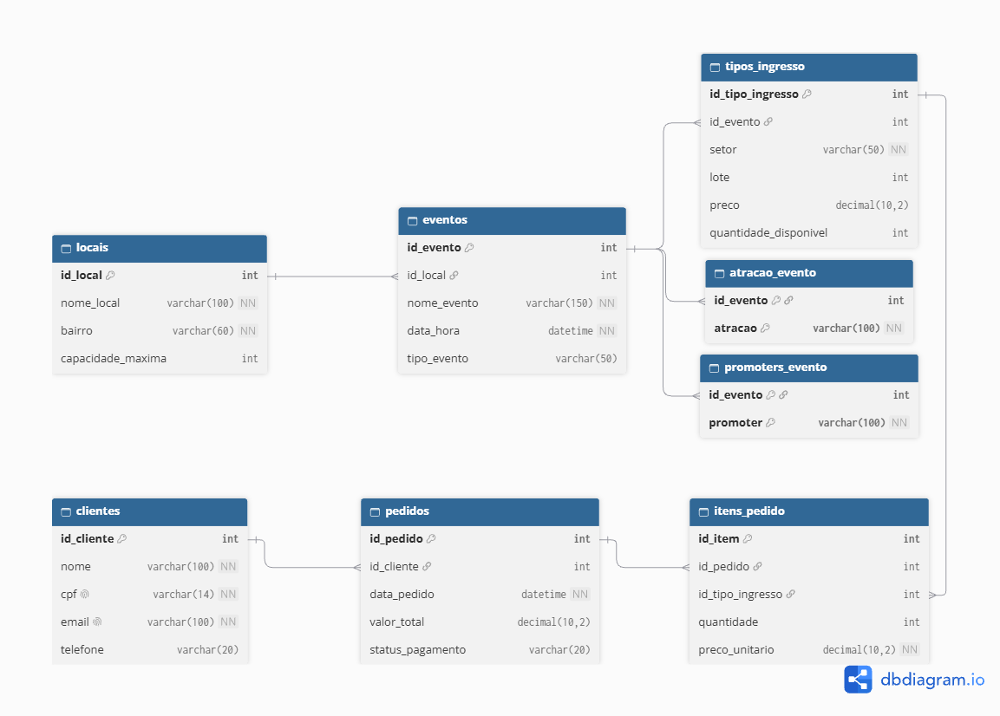

# MySelf Tickets DB - Sistema de Gestão de Ingressos

## Sumário
1. [Domínio do Banco de Dados](#1-domínio-do-banco-de-dados)
2. [Contextualização](#2-contextualização)
3. [Proposta de Melhoria](#3-proposta-de-melhoria)
4. [Modelagem Lógica](#4-modelagem-lógica)
5. [Aplicações das Formas Normais](#5-aplicações-das-formas-normais-1fn-2fn-3fn-e-4fn)
6. [Instruções SQL](#6-instruções-sql)
7. [Hosting na Cloud](#7-hosting-na-cloud)
8. [Procedimento de Dump](#8-procedimento-de-dump)
9. [Deploy e Estrutura do Repositório](#9-deploy-e-estrutura-do-repositório)

---

## 1. Domínio do Banco de Dados

**Projeto:** MySelf Tickets DB

**Empresa:** Produtora de Eventos MySelf

**Descrição do Domínio:** Sistema de gerenciamento de dados focado na comercialização de ingressos, controle de estoque por lotes e setores, e gestão dos eventos exclusivos promovidos pela produtora **MySelf** na Zona Sul. O domínio abrange desde o cadastramento de locais de eventos parceiros e edições especiais até o cadastro de clientes, histórico de compras, controle de atrações/DJs convidados, promotores e acompanhamento do faturamento por edição.

---

## 2. Contextualização

A **MySelf** é uma produtora de eventos/festas de trap underground, variando entre edições regulares e eventos de grande porte (como a *MYSELF x ECHO DIMENSIONAL FUTURE*, *HELLSING GLOCK BOYZ x MYSELF WEB* e *MYSELF WEB: AFTER APOLOGY*).

Atualmente, a gestão operacional da produtora — que envolve a venda de ingressos, controle de setores/lotes, cadastro de frequentadores e gestão de promotores/DJs — depende de processos manuais, planilhas eletrônicas descentralizadas e listas de transmissão via aplicativos de mensagem.

### Problemas Enfrentados sem um SGBD Relacional

1. **Risco de Overbooking e Vendas Acima da Capacidade:**
   * **Problema:** Sem controle centralizado e atômico das transações, ingressos de um mesmo setor/lote podem ser vendidos simultaneamente por diferentes canais ou promotores.
   * **Impacto:** Vendas acima da capacidade física dos locais parceiros, gerando filas excessivas, problemas de segurança e violação do alvará de funcionamento do espaço.

2. **Inconsistência e Duplicidade no Cadastro de Clientes:**
   * **Problema:** O mesmo cliente possui dados repetidos ou divergentes em diferentes planilhas de eventos passados.
   * **Impacto:** Impossibilidade de rastrear o histórico de compras do público frequente, dificultando ações de fidelização e vendas direcionadas para edições especiais.

3. **Perda de Histórico e Descontrole de Lotes/Preços:**
   * **Problema:** Alterações de preços entre 1º, 2º e 3º lotes são registradas de forma manual e sem validação prévia.
   * **Impacto:** Ingressos do 1º lote continuam sendo emitidos após a virada de lote oficial, gerando perda financeira para a produtora.

4. **Incapacidade de Gerar Relatórios Financeiros em Tempo Real:**
   * **Problema:** Para apurar a receita total de um evento (ex: *MYSELF WEB: AFTER APOLOGY*), é necessário consolidar manualmente dados de múltiplos promotores, plataformas de pagamento e taxas do local.
   * **Impacto:** Lentidão na prestação de contas com atrações/DJs convidados e atraso nas tomadas de decisão estratégica para os próximos eventos.

5. **Ausência de Integridade Referencial:**
   * **Problema:** Ingressos e pedidos podem ficar vinculados a atrações canceladas ou locais incorretos sem qualquer alerta automático do sistema.
   * **Impacto:** Falhas operacionais no dia do evento e retrabalho para a equipe organizadora.

---

## 3. Proposta de Melhoria

A implementação do **MySelf Tickets DB** em um SGBD Relacional resolve os gargalos operacionais da produtora com as seguintes soluções:

- **Integridade Referencial e Vínculos Obrigatórios:** Chaves estrangeiras (`FOREIGN KEY`) garantem que ingressos, atrações e pedidos estejam sempre vinculados a eventos válidos.
- **Controle Estrito de Capacidade e Lotes:** Uso de restrições (`CHECK`) para impedir vendas acima da capacidade do local ou emissão de ingressos com valores negativos.
- **Unificação do Cadastro de Clientes:** Eliminação de duplicidades por meio de restrições de unicidade (`UNIQUE`) nos campos de CPF e e-mail.
- **Automação de Relatórios com Consultas SQL:** Apuração instantânea do faturamento por festa, ingressos vendidos por lote e acompanhamento de receita via comandos de agregação (`SUM`, `COUNT`, `GROUP BY`).

---

## 4. Modelagem Lógica



### Tabelas e Estrutura de Campos

1. **`locais`**
   * `id_local` (`INT`, PK, Auto Increment)
   * `nome_local` (`VARCHAR(100)`, NOT NULL)
   * `bairro` (`VARCHAR(60)`, NOT NULL)
   * `capacidade_maxima` (`INT`, CHECK > 0)

2. **`eventos`**
   * `id_evento` (`INT`, PK, Auto Increment)
   * `id_local` (`INT`, FK -> `locais.id_local`)
   * `nome_evento` (`VARCHAR(150)`, NOT NULL)
   * `data_hora` (`DATETIME`, NOT NULL)
   * `tipo_evento` (`VARCHAR(50)`)

3. **`tipos_ingresso`**
   * `id_tipo_ingresso` (`INT`, PK, Auto Increment)
   * `id_evento` (`INT`, FK -> `eventos.id_evento`)
   * `setor` (`VARCHAR(50)`, NOT NULL) — *Ex: Pista, Área VIP, Backstage*
   * `lote` (`INT`, DEFAULT 1) — *Ex: 1, 2, 3*
   * `preco` (`DECIMAL(10,2)`, CHECK >= 0)
   * `quantidade_disponivel` (`INT`, CHECK >= 0)

4. **`clientes`**
   * `id_cliente` (`INT`, PK, Auto Increment)
   * `nome` (`VARCHAR(100)`, NOT NULL)
   * `cpf` (`VARCHAR(14)`, UNIQUE, NOT NULL)
   * `email` (`VARCHAR(100)`, UNIQUE, NOT NULL)
   * `telefone` (`VARCHAR(20)`)

5. **`pedidos`**
   * `id_pedido` (`INT`, PK, Auto Increment)
   * `id_cliente` (`INT`, FK -> `clientes.id_cliente`)
   * `data_pedido` (`DATETIME`, NOT NULL)
   * `valor_total` (`DECIMAL(10,2)`, CHECK >= 0)
   * `status_pagamento` (`VARCHAR(20)`)

6. **`itens_pedido`**
   * `id_item` (`INT`, PK, Auto Increment)
   * `id_pedido` (`INT`, FK -> `pedidos.id_pedido`)
   * `id_tipo_ingresso` (`INT`, FK -> `tipos_ingresso.id_tipo_ingresso`)
   * `quantidade` (`INT`, CHECK > 0)
   * `preco_unitario` (`DECIMAL(10,2)`)

7. **`atracao_evento`** *(Relacionamento N:M de atrações)*
   * `id_evento` (`INT`, FK -> `eventos.id_evento`)
   * `atracao` (`VARCHAR(100)`)
   * *PK Composta:* (`id_evento`, `atracao`)

8. **`promoters_evento`** *(Relacionamento N:M de promoters)*
   * `id_evento` (`INT`, FK -> `eventos.id_evento`)
   * `promoter` (`VARCHAR(100)`)
   * *PK Composta:* (`id_evento`, `promoter`)

### Relacionamentos e Cardinalidade

| Tabela Origem | Tabela Destino | Tipo | Cardinalidade |
|---|---|---|---|
| `locais` | `eventos` | 1:N | Um local sedia N edições de festas da MySelf. |
| `eventos` | `tipos_ingresso` | 1:N | Um evento possui N tipos/lotes de ingressos. |
| `clientes` | `pedidos` | 1:N | Um cliente realiza N compras no sistema. |
| `pedidos` | `itens_pedido` | 1:N | Um pedido contém N itens de ingressos. |
| `tipos_ingresso` | `itens_pedido` | 1:N | Um tipo de ingresso é vendido em N itens de pedido. |
| `eventos` | `atracao_evento` | 1:N | Um evento possui N atrações/DJs convidados. |
| `eventos` | `promoters_evento` | 1:N | Um evento possui N promoters divulgadores. |

---

## 5. Aplicações das Formas Normais (1FN, 2FN, 3FN e 4FN)

A modelagem do **MySelf Tickets DB** seguiu rigorosamente os princípios de normalização de dados para garantir performance e ausência de anomalias de inserção, alteração ou exclusão:

1. **Primeira Forma Normal (1FN):**
   * **Regra:** Todos os atributos possuem valores atômicos (indivisíveis) e não existem colunas multivaloradas ou grupos de repetição.
   * **Aplicação:** Dados de contato de clientes e endereços de locais foram atomicizados. Não há campos armazenando vetores de telefones ou múltiplos ingressos em uma só coluna.

2. **Segunda Forma Normal (2FN):**
   * **Regra:** A tabela está na 1FN e todos os atributos não-chave dependem totalmente da Chave Primária (`PK`) e não de parte dela.
   * **Aplicação:** Na tabela `itens_pedido`, atributos como `quantidade` e `preco_unitario` dependem estritamente da chave atômica daquele item do pedido.

3. **Terceira Forma Normal (3FN):**
   * **Regra:** A tabela está na 2FN e não existem dependências transitivas entre atributos não-chave.
   * **Aplicação:** Informações do local do show (como `capacidade_maxima` e `bairro`) pertencem exclusivamente à tabela `locais`, evitando que fossem duplicadas na tabela de `eventos`.

4. **Quarta Forma Normal (4FN):**
   * **Regra:** A tabela está na 3FN (ou BCFN) e não possui dependências multivaloradas independentes na mesma entidade.
   * **Aplicação:** Eventos da MySelf possuem múltiplas atrações/DJs e múltiplos promoters independentes entre si. Em vez de criar uma tabela única gerando produto cartesiano, foram criadas as entidades fracionadas `atracao_evento` e `promoters_evento`.

---

## 6. Instruções SQL

Os scripts SQL completos do projeto estão organizados na pasta `sql/`:

- **`sql/01_schema.sql`**: Contém a definição da estrutura (DDL), criação das 8 tabelas e definição de constraints (`PRIMARY KEY`, `FOREIGN KEY`, `UNIQUE`, `CHECK`).
- **`sql/02_seed.sql`**: Script DML para povoamento inicial com dados das festas de trap da MySelf, clientes, ingressos e pedidos.
- **`sql/03_queries.sql`**: Conjunto de 15 consultas SQL contextualizadas cobrindo `INNER JOIN`, `GROUP BY`, `SUM`, `AVG`, `COUNT`, `HAVING`, `BETWEEN` e `LIKE`.

### Resumo das 15 Consultas SQL Desenvolvidas
1. **Consulta 1:** Listar todas as festas com nome do local e bairro (`INNER JOIN`).
2. **Consulta 2:** Listar setores e preços do evento *MYSELF x ECHO DIMENSIONAL FUTURE* (`WHERE` + `INNER JOIN`).
3. **Consulta 3:** Vendas aprovadas ordenadas por valor total (`ORDER BY`).
4. **Consulta 4:** Buscar eventos que possuem a marca "WEB" no nome (`LIKE`).
5. **Consulta 5:** Faturamento total acumulado em pedidos aprovados (`SUM`).
6. **Consulta 6:** Quantidade de ingressos comprados por cliente (`GROUP BY` + `SUM`).
7. **Consulta 7:** Ingressos com preço entre R$ 80,00 e R$ 200,00 (`BETWEEN`).
8. **Consulta 8:** Preço médio de todos os ingressos cadastrados (`AVG`).
9. **Consulta 9:** Total de atrações/DJs confirmados por evento (`COUNT` + `GROUP BY`).
10. **Consulta 10:** Locais da Zona Sul com capacidade superior a 1.500 pessoas (`WHERE`).
11. **Consulta 11:** Detalhamento completo dos pedidos executados (`Múltiplos JOINs`).
12. **Consulta 12:** Listar os promoters associados a cada evento (`INNER JOIN`).
13. **Consulta 13:** Clientes VIPs com gasto acumulado maior que R$ 100,00 (`HAVING`).
14. **Consulta 14:** Pedidos realizados no mês de Outubro/2026 (`BETWEEN` de datas).
15. **Consulta 15:** Contagem de eventos agrupados por categoria/tipo (`COUNT` + `GROUP BY`).

---

## 7. Hosting na Cloud

O banco de dados relacional foi implantado em ambiente de nuvem gerenciada através da plataforma **Aiven for MySQL**.

### Passos de Configuração na Nuvem:
1. Instância do **MySQL 8.4** criada na região `AWS / South America (São Paulo)`.
2. Conexão remota estabelecida via SSL utilizando o **MySQL Workbench** com o usuário administrativo `avnadmin`.
3. Execução dos scripts `01_schema.sql` e `02_seed.sql` para montagem e povoamento do ambiente de produção.

---

## 8. Procedimento de Dump

Para garantir o versionamento e a portabilidade do banco de dados completo (estrutura + dados), foi gerado o arquivo de dump unificado na pasta `sql/dump_myself.sql`.

### Comando utilizado para geração do Dump via linha de comando:
```bash
mysqldump -h <HOST_AIVEN> -P <PORTA> -u avnadmin -p --databases myself_tickets_db > sql/dump_myself.sql